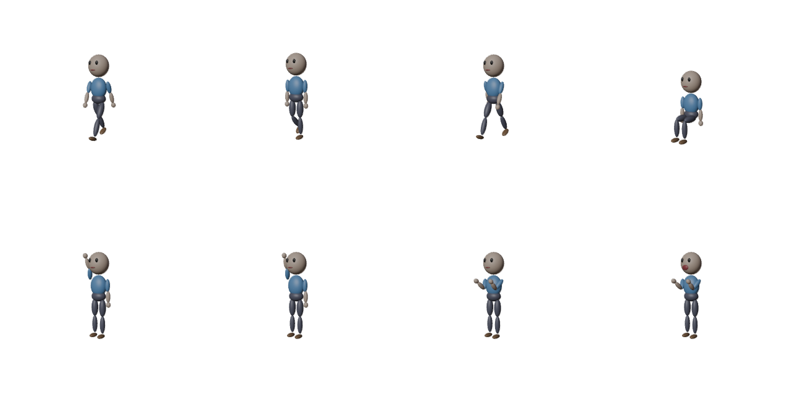
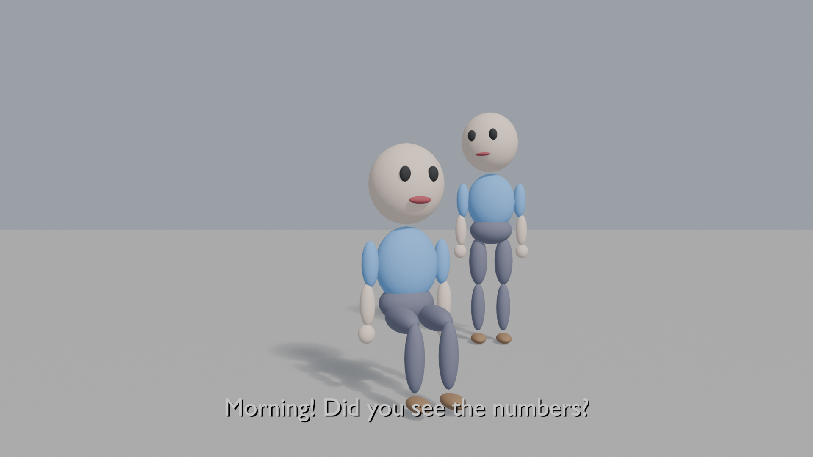

# CSK360 — Creator Shortcuts Kit for Blender

CSK360 is a free, open-source Blender extension for making character animation
without keyframes: put a character in the cast, add poses and actions as
**clips** with a start and a duration, walk it somewhere, give it dialogue, and
CSK360 builds the NLA tracks, keys and sound strips for you.

It is aimed at creators of animated podcasts, explainers, vlogs and short
cartoons, and at AI agents that build the same scenes from a script.

> Status: **v0.1, early development** (Phase 1 of the roadmap). The data model,
> compiler, clip timing, simple walk-to-point and dialogue/mouth keys work and are
> covered by headless tests. Voice generation, Rhubarb lip-sync analysis, the
> pose picker, viewport handles, path planning and the asset library are next.

## What works today

| Feature | How |
| --- | --- |
| Starter character | **CSK360 tab → Add Starter Character**: a code-built 3D toon (`biped_toon` bones, mouth shape keys driven by the `mouth` control) plus starter actions `idle`, `walk`, `wave`, `arms_crossed`, `sit` |
| Cast | Or use your own rig: select it, **CSK360 tab → Cast → +** |
| Pose and action clips | Clips on Body / Gesture / Face layers, at the playhead, with default length from the library |
| Clip length | `]` / `[` ±1 second, `Shift` ±1 frame (Object Mode), or the −1 s / +1 s buttons |
| Clip modes | **Loop** repeats to fill, **Once** plays then holds the last pose, **Pose** holds a still |
| Layering | Gesture and Face clips use *Combine* blending over the Body layer; overlapping clips get extra tracks automatically |
| Walk to a point or object | Straight-line walk, speed from the walk cycle's stride so feet don't slide; walks to an object's `*approach*` child empty; optional arrival action (e.g. sit) |
| Dialogue lines | Audio file → sound strip; mouth shapes (Rhubarb A–H, X) keyed on the rig's `mouth` property; moving a line moves voice and lips together |
| Voices | **Voices → Install Voices** once (about 900 MB, offline afterwards). Then type a line and press **Generate**: it is spoken with Kokoro or Supertonic 3, lip-synced with Rhubarb, and placed on the timeline. Only new or edited lines are regenerated |
| Manual layer | Your own keys in the object's active action and your own NLA tracks are never touched |



The starter character is a placeholder made of simple shapes so the workflow
can be built and tested before real art exists. Regenerate this sheet with
`blender -b --factory-startup -P tools/preview_starter.py -- docs/starter_preview.png`.

Everything the panels do is also a Python call in `csk360.commands`, so scripts
and agents get identical results (see [AGENTS.md](AGENTS.md)).

## Requirements

* Blender **5.3**. Older versions (e.g. 4.5 LTS) may be supported later.

## Install

1. Build the zip: `./tools/build.ps1` (or download a release).
2. In Blender: **Edit → Preferences → Get Extensions → ⌄ → Install from Disk…** and pick `dist/csk360-<version>.zip`.
3. Open the 3D Viewport sidebar (`N`) and find the **CSK360** tab.

To use one of your own actions as a library item, assign it to an object and
press **Library → Add Action to Library**, then set its kind (pose, action,
transition), layer, loop, default duration and stride.

## Scene scripts (for agents and batch work)

One text file builds a whole scene. Three formats are accepted: YAML in the
shape of the design doc, the same structure as JSON, and Frameling's
screenplay text (`Maya (happy, wave): Hi Leo!`). See [examples/](examples).

```powershell
blender -b -P csk360/csk360_build.py -- examples/coffee_break.yaml --save dist/coffee_break.blend
blender -b -P csk360/csk360_build.py -- examples/coffee_break.yaml --validate   # check only
```



Add `--render out.mp4` (with `--engine eevee|workbench` and `--subtitles srt|burn|both|none`)
to render a video with sound. Without a camera or lights, CSK360 adds a front
camera that frames the cast and a simple stage.

Characters that don't exist in the .blend are created as starter characters.
Errors name the timeline entry and suggest fixes ("no pose or action 'wavee'.
Did you mean: wave?"). `--json` prints a machine-readable report.

## Voices and lip sync

Speech runs in a separate background process with its own Python environment
(created from Blender's own Python), so nothing heavy is loaded into Blender.
Everything is stored in one folder shared by all Blender versions:
`~/.csk360` (or set the `CSK360_HOME` environment variable).

| Part | Used for | Licence |
| --- | --- | --- |
| [Kokoro-82M](https://huggingface.co/hexgrad/Kokoro-82M) via [kokoro-onnx](https://github.com/thewh1teagle/kokoro-onnx) | Default voices (`kokoro/af_heart`, `kokoro/am_michael`, …) | Apache-2.0 / MIT |
| [Supertonic 3](https://huggingface.co/Supertone/supertonic-3) | Voices `supertonic/F1`…`M5`, 31 languages (`supertonic/M2@de`) | **BigScience OpenRAIL-M**: use restrictions; you must accept them in the Voices panel first, disclose generated speech as machine-generated and not impersonate real people |
| [Rhubarb Lip Sync](https://github.com/DanielSWolf/rhubarb-lip-sync) 1.14 | Mouth shapes A–H, X from the audio and text | MIT |
| ONNX Runtime, NumPy, phonemizer, espeak-ng | Running the models | MIT / BSD / GPL-3.0 |

Generated audio is cached by text + voice + speed, so re-generating is instant.
Rhubarb's English recogniser is used for English voices and its phonetic
recogniser for other languages. Generated files currently live in the voice
folder's `cache`, not next to the .blend, so copy them if you move the project
to another computer.

## Development

```powershell
$env:BLENDER = "C:\path\to\blender.exe"   # if blender is not on PATH
./tools/test.ps1            # headless test suite
./tools/test.ps1 -k move    # only tests matching "move"
./tools/build.ps1           # validate the manifest and build dist/csk360-<version>.zip
```

Layout:

```
csk360/              the extension (this folder is what gets zipped)
  blender_manifest.toml
  model.py           PropertyGroups: cast, clips, moves, dialogue lines (saved in the .blend)
  library.py         pose/action library metadata on Actions
  commands.py        command layer used by the UI and by agents
  compiler.py        model -> NLA tracks, generated actions, sound strips
  operators.py, ui.py, keymaps.py
tests/               unittest suite run inside Blender
tools/               test and build scripts
```

Design rules:

* The CSK360 model is the single source of truth. Only `compiler.py` writes
  animation data, and it only touches tracks named `CSK360 …`, actions named
  `CSK360.<cast>.…` and sound strips named `CSK360:<line>`.
* The UI and agents never write keyframes directly; they call `commands`.
* Heavy dependencies (TTS, ML) will run in a separate process, never inside Blender's Python.

## Licence

GPL-3.0-or-later, see [LICENSE](LICENSE). Bundled or downloadable assets and
third-party tools will carry their own licences, listed alongside them.
