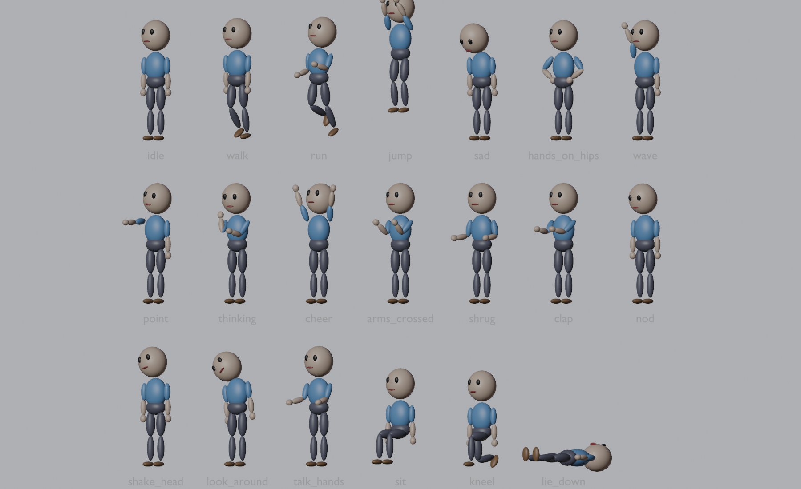

# Poses and actions: using the library and adding your own



CSK360 ships 20 starter poses and actions that work on every starter character:

| Category | Assets |
|---|---|
| Standing | idle, sad, hands_on_hips |
| Gestures | wave, point, thinking, cheer, arms_crossed, shrug, clap, nod, shake_head, look_around, talk_hands |
| Sitting and kneeling | sit, kneel |
| Lying | lie_down |
| Motion keys | walk, run, jump |

Press **P** with a character selected for the pie menu (favourites), or **More…** /
**Pick Pose or Action…** for the full picker with categories and search.
Gestures move only the upper body, so they layer over a walk or a sit.

## Save your own pose (no keyframes needed)

1. Select the character and switch to **Pose Mode** (Ctrl+Tab).
2. Pose it: select bones and rotate with **R** (or move with **G**).
3. Press **Ctrl+Shift+P** (or the **+** next to *Pick Pose or Action…*).
4. Give it a name, pick a category, and press OK.

CSK360 keys only the bones you moved. If you only moved arms, head or chest it
becomes a **Gesture** (layers over walks and sits); if you moved legs or hips
it becomes a **Body** pose. It is added as a clip at the playhead, appears in the
picker under **My poses**, and in the pie menu if you tick *Show in Pie Menu*.

Poses work on every character with the same bone names, so a pose made on Leo
plays on Maya too.

## Save your own action (animated)

1. Animate the character the usual way (keyframes on its active action).
2. In the **Library** panel press **Add Action to Library**, choose *Action*,
   the layer, whether it loops (walk cycles, talk gestures) and, for walk
   cycles, the stride in metres.

The action is unassigned from the character so it plays only as a clip.

## From a script

```python
from bl_ext.user_default.csk360 import commands, library

name = commands.save_pose(scene, "leo", "Salute", category="Gestures", favorite=True)
commands.add_clip(scene, "maya", name, start=3)

library.mark(bpy.data.actions["my_dance"], kind="action", layer="BODY", loop=True,
             category="Motion keys", tags="dance, party")
```

Library assets are ordinary Blender actions (with a `csk360` custom property),
so you can append them from another .blend or share them in an asset library.
