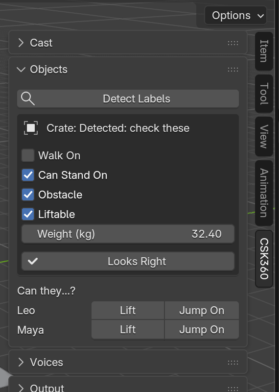
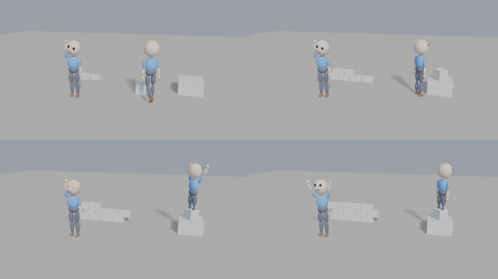

# Objects and abilities

CSK360 knows what characters can do with the things in your scene.



## Label objects

Open **CSK360 > Objects** and press **Detect Labels**. Every unlabelled mesh gets
a guess from its size:

| Label | Meaning | Detected when |
|---|---|---|
| Walk On | a floor | big (4 m² or more) and at floor level |
| Can Stand On | characters can jump or climb onto its top | top 15 cm to 1.5 m up, at least 30 × 30 cm |
| Obstacle | characters walk around it | taller than 15 cm |
| Liftable | characters can pick it up if strong enough | longest side 1.2 m or less |
| Weight | kg, used for lifting | bounding box volume × 150 kg/m³ |

Detected labels say *Detected: check these*. Change anything that's wrong, or
press **Looks Right**; either way the labels become yours and detection never
changes them again (unless you tick *Redo* in Detect Labels).

## Character abilities

Each cast member has abilities in the Cast panel:

* **Weight (kg)**: how heavy they are when someone lifts them (default 60)
* **Can Lift (kg)**: the heaviest thing they can lift alone (default 25)
* **Jump Height**: the highest surface they can jump onto (default 0.5 m)

Select an object and the Objects panel shows **Lift** and **Jump On** buttons for
each character. They answer in plain English, for example
*"Leo can't lift Crate: it weighs 40 kg and Leo can lift 25 kg (15 kg short)."*
Characters can lift together: their strengths add up.

## In scene scripts

```yaml
cast:
  leo:  {character: leo, strength: 40, jump: 0.6, weight: 70}
objects:
  Crate: {liftable: true, weight: 12, jump_onto: true}
```

## Pick up, carry and put down

Click the object, then Shift+click the character (so both are selected and the
character is active), and press **Pick Up Selected** in the Movement panel. If the object is out of reach the character walks over first.
CSK360 checks the weight against the character's strength and says why not
when it's too heavy. While carrying, the character holds the object in front of
the chest (the *carry* pose plays on the Gesture layer) and it travels with them.

**Put Down** puts it on the floor in front of the character, on top of another
selected object, or at the 3D cursor (walking there first when needed).

In scripts:

```yaml
timeline:
  - {at: 0, who: leo, pick_up: Box}
  - {after: prev, who: leo, put_down: Shelf}      # or [x, y], or front
  - {at: 6, who: maya, pick_up: Crate, helpers: [leo]}   # strengths add up for the check
```

## Jump onto things

In click-to-walk (**M**), **Alt+click** a surface to walk up to it and jump on.
CSK360 checks the top's height against the character's **Jump Height** and says
why not if it's too high. Walking somewhere lower afterwards jumps down first.
In scripts: `{at: 3, who: maya, jump_onto: Step, then: cheer}`.

## Make things appear (spawn)

Select an object and press **Make It Appear** in the Objects panel. A copy (or the
object itself) pops in at the playhead, at the 3D cursor, where it is, or in front
of the character who makes it (that character points while making it). One
template object can become a whole wall:



```yaml
timeline:
  - {at: 0.5, who: leo, spawn: Brick, place: [-1.0, 0.5]}
  - {at: 0.9, who: leo, spawn: Brick, place: [-0.58, 0.5]}
  - {at: 2,  spawn: Lamp}                     # nobody makes it; it just appears
```

Spawned copies keep their labels, so characters can pick them up and carry them.
See `examples/build_wall.py` for the scene above, written in Python.
